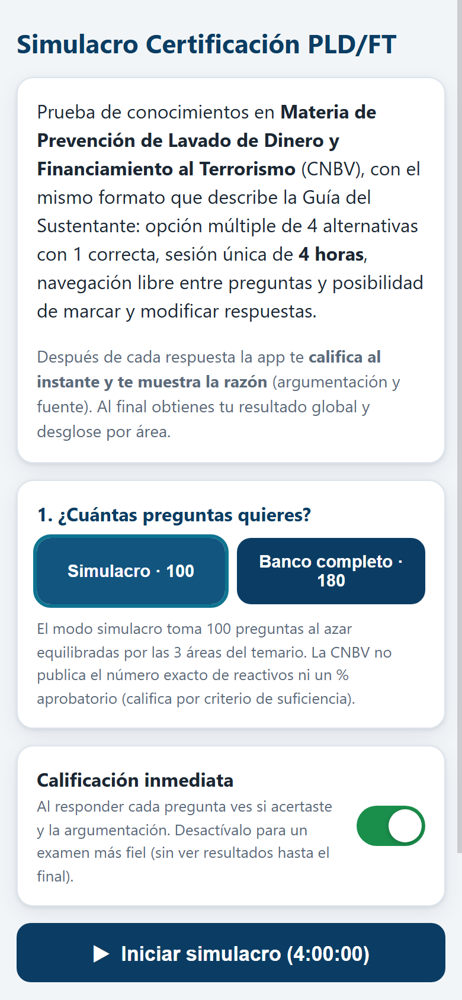
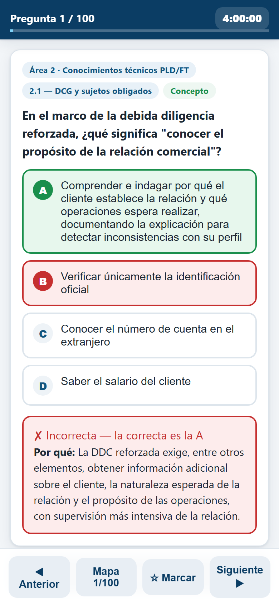
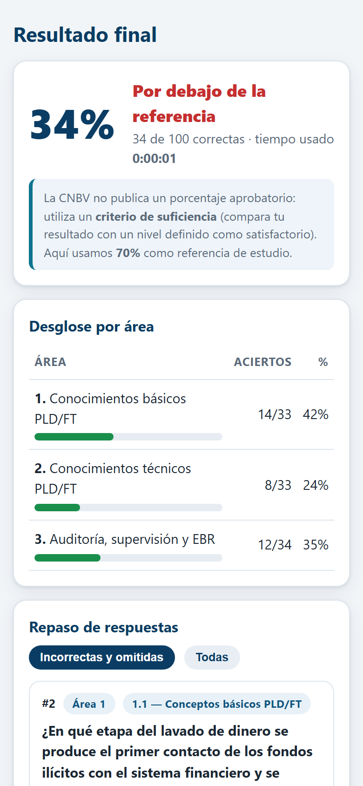

# Simulacro Certificación PLD/FT — CNBV 2026

Simulacro de examen **en línea y para celular** de la Prueba de Conocimientos en Materia de Prevención de Lavado de Dinero y Financiamiento al Terrorismo de la CNBV. Mismo formato que describe la *Guía para el Sustentante*:

**Publicado en:** <https://sergiocortina.github.io/pld/simulacro/> (enlace también en la última slide de la [presentación del curso CANADEVI](../Curso_CANADEVI_Antilavado_2026.html)).

- Opción múltiple: **4 alternativas, 1 correcta**.
- **Sesión única de 4 horas** con cuenta regresiva (se califica solo al terminar el tiempo si no lo haces antes).
- **Navegación libre**: ir y volver entre preguntas, mapa de preguntas para saltar a cualquiera.
- **Marcar preguntas** para revisar y **modificar respuestas** antes de terminar (como en el examen real).
- **Calificación inmediata tras cada respuesta**: te dice si acertaste, resalta la correcta y te muestra **la razón (argumentación)** con base en las fuentes del temario.
- **Resultado final**: porcentaje global, **desglose por área** con barras y repaso completo de incorrectas.
- **Todo en el navegador** (funciona en el celular sin app; si cierras la sesión, puedes continuar donde la dejaste).

| Configuración | Examen (con calificación inmediata) | Resultados |
|---|---|---|
|  |  |  |

## Usarlo en el celular (GitHub Pages)

1. Sube el contenido de esta carpeta a un repositorio de GitHub (`index.html` debe quedar en la **raíz** del repo, o en `docs/`).
2. En GitHub: **Settings → Pages → Source: Deploy from a branch** → rama `main`, carpeta `/` (o `/docs`) → **Save**.
3. En un par de minutos queda publicado en `https://TU-USUARIO.github.io/TU-REPO/`. Ábrelo desde el navegador del celular y, si lo quieres a mano, usa **“Agregar a pantalla de inicio”** para que funcione como app.

> `index.html` es **autónomo**: lleva las 180 preguntas embebidas, así que no necesita servidor ni conexión después de cargarlo (incluso sirve abrirlo con doble clic desde la PC).

## Modos

- **Simulacro · 100**: toma 100 preguntas al azar, equilibradas entre las 3 áreas del temario (33/33/34).
- **Banco completo · 180**: todas las preguntas (opción para repaso exhaustivo).
- **Calificación inmediata** (activada por defecto, lo pedido para estudiar): puedes apagarla para un examen más fiel, sin ver resultados hasta el final.

## Aclaraciones importantes

- La CNBV **no publica** el número exacto de reactivos del examen ni un porcentaje aprobatorio: la Guía del Sustentante indica que la calificación usa un **criterio de suficiencia** (compara tu resultado con un nivel definido como satisfactorio). Este simulacro usa **70% como referencia de estudio**, no como umbral oficial.
- Es **material de estudio no oficial**, construido con el banco del material `_BANCO_PREGUNTAS.md`, las fuentes de la Biblioteca PLD/FT (DCG, leyes, GAFI, ENR, tipologías) y preguntas nuevas autoradas y contrastadas contra esas fuentes. No sustituye al temario ni a la Guía Oficial.

## Presentación de Canadevi

Para subirla junto con el simulacro: coloca el archivo en **PDF** en esta carpeta (por ejemplo `Presentacion_Canadevi.pdf`) y enlázalo en este README. GitHub Pages **no renderiza** `.pptx`/`.key`, así que conviene exportarla a PDF antes de subirla.

## Estructura y regeneración

| Archivo | Para qué |
|---|---|
| `index.html` | La app completa (autónoma, con el banco embebido) |
| `preguntas.json` | Las 180 preguntas en JSON (para revisar/editar) |
| `_plantilla.html` | Plantilla de la app (marca `__BANCO_JSON__`) |
| `preguntas_banco.json` | Banco original parseado de `_BANCO_PREGUNTAS.md` (114) |
| `preguntas_nuevas.json` | 66 preguntas nuevas autoradas (conversiones + equilibradas) |
| `_parse_banco.py` | Parser del banco original (referencia) |
| `_compilar.py` | **Regenera** `preguntas.json` e `index.html` validando todo |
| `_test_app.js` | Smoke test end-to-end (Chrome headless + CDP, 31 aserciones) |
| `_shots.js` | Genera las capturas de `docs/` |

**Para agregar preguntas:** edita `preguntas_nuevas.json` (mismo formato: `area`, `subarea`, `tipo`, `q`, `opciones` A–D, `correcta`, `argumentacion`) y vuelve a compilar:

```bash
python _compilar.py   # valida integridad, baraja opciones y regenera index.html
node _test_app.js     # smoke test completo del flujo (requiere Chrome)
```

El compilador valida: esquema completo, 4 opciones sin repetir, letra correcta válida, enunciados y argumentaciones suficientes, y **ausencia de duplicados**. Las opciones se barajan con semilla fija para equilibrar la letra correcta (~25% cada una).
